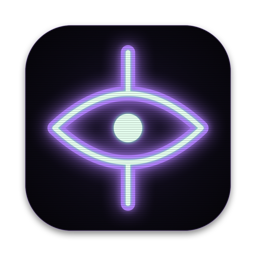

# Grimoire



A retro music player for Mac and Windows, styled like a glowing spell terminal. It plays MP3, WAV, AIFF and FLAC files and .m3u playlists, and comes with eight visualizer scenes, including a wizard and a playable Doom (Freedoom).

This is a personal project, built with [Claude Code](https://claude.com/claude-code).

## Download and install

**[⬇ Download the latest Grimoire](https://github.com/neonspellcraft/grimoire/releases/latest)**

- **Windows** (64-bit): download [Grimoire-windows-x64.zip](https://github.com/neonspellcraft/grimoire/releases/latest/download/Grimoire-windows-x64.zip) and extract it. Open the `Grimoire` folder and run `grimoire.exe`, keeping the other files beside it.
- **Mac** (macOS 12 or later, Apple Silicon or Intel): download [Grimoire-mac.dmg](https://github.com/neonspellcraft/grimoire/releases/latest/download/Grimoire-mac.dmg), open it and drag **Grimoire** onto **Applications**.

Grimoire isn't code-signed, so the first launch needs one extra step:

- **Windows:** if it says "Windows protected your PC", click **More info → Run anyway**. This can come back after each update.
- **Mac:** open Grimoire once and dismiss the warning, then go to **System Settings → Privacy & Security** and click **Open Anyway**.

To update, download the new version and replace the old app (Mac) or folder (Windows). Your settings and playlist are kept.

## Using it

- Drop audio files, folders or .m3u playlists on the window, or click **+**.
- Click the prompt and type to search the playlist. **Enter** plays the match.
- **Space** plays and pauses, **← / →** seek (hold **Shift** for 30 s) and **⌘ / Ctrl + ← / →** skip tracks. Right-click a track or anywhere else for a menu.
- **⌘ / Ctrl + V** opens the visualizer window. Inside it, **1–8** or **Tab** switch scenes and a double-click goes full screen. The scenes are Three-Body, Viewscreen, Spellrun, Splatter, Wizard, Night Clouds, Black Hole and Doom.
- **⚙** opens settings: keyboard shortcuts, the visualizer scene, band meters and Doom's controls and sound.
- Media keys work, as do Control Center on the Mac and the media overlay on Windows.

## Source and license

The cross-platform app is written in Rust and lives on the [`rust-port`](https://github.com/neonspellcraft/grimoire/tree/rust-port/rs) branch. Its [README](https://github.com/neonspellcraft/grimoire/blob/rust-port/rs/README.md) covers building, testing, packaging and every shortcut.

Grimoire is free software under the GNU GPL, version 2 or later, because it includes the Doom engine. Freedoom and the fonts have their own free licenses, which ship with the app.

## The original Swift app

Grimoire started as a native Swift app for macOS 14 or later, with no dependencies and its own icon. The code on this branch is that app. Everything below describes it, not the download above.

### Build and install

Run `scripts/make-dmg.sh` to build `dist/Grimoire-<version>.dmg`. Open it and drag **Grimoire** onto **Applications**. The app is universal (Apple Silicon and Intel).

The app isn't signed with an Apple Developer ID, so on a Mac other than the one that built it, macOS blocks the first launch. Try to open it once, then go to **System Settings → Privacy & Security** and click **Open Anyway**. The comments at the top of `scripts/make-dmg.sh` explain how to sign and notarize it if you have a Developer ID.

### Develop

```sh
./bundle.sh            # universal release build → build/Grimoire.app
open build/Grimoire.app
swift test             # core logic tests
open Package.swift     # work on it in Xcode
```

### Using it

- Drop files or folders on the main window to play them, or on the playlist to add them.
- **Space** plays/pauses, **← / →** seek 5 s, **⌘O** opens files, **⌘⇧O** opens a folder, **⌘L** shows/hides the playlist, **⌘S** saves the playlist.
- Click the time to switch between elapsed and remaining.
- Click the visualizer to cycle **Spectrum → Oscilloscope → Off**, or right-click it / use Window → Visualization.
- **VIS** (or **⌘⇧V**) opens the visualizer window. Resize it, drag it anywhere, and double-click for full screen. Pick a scene from Window → Visualizer Scene or by right-clicking the window, which also has band meters and an option to restart the scene.
- Drag the playlist away to float it. Drag it back under the main window to dock it.
- Media keys and Control Center work. The playlist is restored on the next launch.

### Layout

- `Sources/GrimoireCore` contains pure logic (playlist, m3u, FLAC tags, time math, FFT, multiband analysis, three-body physics) and is unit tested.
- `Sources/Grimoire/Audio` has `PlayerEngine` (AVAudioEngine playback), `AudioTap` (samples for visualizers) and `TrackLoader` (tags).
- `Sources/Grimoire/Model` has `PlayerController` (app state) and `NowPlaying` (media keys).
- `Sources/Grimoire/UI` holds the SwiftUI views, `UI/Visualizers/` the small LCD visualizers and `UI/SceneWindow/` the Metal visualizer window. `App/` holds windows, menus and the app delegate.
- `scripts/` holds `make-dmg.sh` (installer) and `make-icon.swift` (redraws `Resources/AppIcon.icns`).

### Visualizers

`AudioTap` captures the player node's output (before volume) into a ring buffer. `VisualizerNSView` pulls a 2,048-sample window on every display refresh and hands it to the active `Visualization`. The view is layer-backed and driven by a display link, so it pauses when nothing is moving.

To add a style, write a class that conforms to `Visualization` (in `UI/Visualizers/`) and add a case to `VisualizationKind`. `SpectrumAnalyzer` and `BarDynamics` in GrimoireCore provide the FFT bands and the classic rise/fall/peak-hold motion.

#### Visualizer window

`SceneHostView` (MetalKit) reads the tap through its own `TapReader`. It splits the audio into three bands (**0–120 Hz, 120–800 Hz, 800 Hz–20 kHz**) with `MultibandAnalyzer`, and `BandFollower` smooths them into envelopes and transient hits. The current `WindowScene` gets those values every frame. To add a scene, conform to `WindowScene` and add a case to `WindowSceneKind`.

**Three-Body** (`ThreeBodyScene`) runs a Newtonian three-body simulation (`ThreeBodySystem`). It starts from the figure-eight orbit, and each body belongs to one band:
- That band's level sets the body's mass.
- Bass also pumps up gravity, and the mids speed up time.
- A thermostat and a gentle bowl keep the chaotic dance in frame.

The shader draws the bodies' gravitational field as flowing rings, with feedback trails smeared along the pull of gravity. Bass pulses and zooms the image, the mids swirl it and shift its colors, and the highs add sparkle and a split-color edge.

**Viewscreen** (`ViewscreenScene`) is the view out the front of a starship, with the music as the engine:
- **Low = throttle.** It controls a 2,120-star 3D field in four depth layers, where near stars move faster. The response is deliberately laggy, so kicks feel like thrust surges, and stars stretch into warp streaks as the throttle climbs. It idles at a slow drift and never fully stops.
- **Mid = environment.** It sets how opaque and how saturated the drifting nebula is, and the nebula's hue slowly drifts.
- **High = sparkle.** Near stars twinkle, shooting stars streak by, and strong hits put a faint glint on the glass.

The camera sways and rolls slowly, and banks a little on sustained bass. A minimal HUD shows a bezel, a reticle, a heading tape and a throttle readout. Every 30–90 s a planet, moon or asteroid field drifts past on one side. All the colors live in `ViewscreenPalette`.

**Spellrun** (`SpellrunScene`, with the game itself in `GrimoireCore/Spellrun/`) is a generated pixel platformer that the music plays. A little apprentice auto-runs through an endless world:
- **Low:** kicks make the apprentice hop when the ground ahead is safe, big kicks mid-air turn into ground pounds that shake the screen and squish slimes, and beat lanterns and rune blocks glow with the bass.
- **Mid:** sets run speed and how lively the generated terrain is. Calm music makes long meadows; busy music adds gaps, hills, floating platforms and rune blocks.
- **High:** spell bolts that pop bats and shatter rune blocks, motes that the music drops into the air, twinkling stars and the staff gem's glow.

The world cycles through four biomes (Sunlit Meadow, Dusk Forest, Crystal Cavern, Starlit Ramparts) with a pixel-dither dissolve between them. Every gap and step the generator makes can be cleared at minimum speed, and a once-per-jump *staff boost* (a magic double jump) rescues the apprentice from bad bounces. The tests check that the apprentice never falls. The frame is drawn on the CPU at about 256×160, and Metal scales it up by a whole number so every pixel stays sharp. All the art is original and drawn in code.

To try it on real music: `SPELLRUN_TRACK=/path/to/song.aiff SPELLRUN_FRAMES=/some/folder swift test --filter SpellrunMusicTests`. It runs the track through the app's band analysis, reports what the music triggered, and saves a frame every 10 s.

**Splatter** (`SplatterScene`) throws neon paint at a black canvas, and every splat is shaped by a piece of theoretical physics. Each one draws fresh continuous random parameters (phases, spectra, quantum numbers, chaotic initial conditions, rotation and a per-splat color blend), so no two are ever the same.

| Theory | Splat |
|---|---|
| Superstring harmonics | The rim is a closed string vibrating in 6–16 overtones with random phases and spectral tilt. Droplets fly out along the strongest harmonic. |
| Quantum orbital | Lobes of \|cos mθ\|^p, sometimes with a radial node. Its droplets are sampled from a hydrogen-like \|ψ\|². |
| Einstein ring | A lensed ring that thickens into two bright arcs, with a central source and secondary arc images. |
| Cosmic inflation | A thresholded Gaussian random field with power-law speckles. |
| Kerr black hole | Logarithmic spiral arms twisted by frame dragging, with matter streaming off them. |
| Lorenz attractor | A chaotic orbit with randomized ρ, β and starting point, drawn in droplets. |
| Feynman diagram | Two vertices joined by a wavy photon propagator, fermion legs, and sometimes a vacuum-polarization loop. |
| Double slit | Droplets landing in cos² fringes under a sinc² envelope. |
| Brownian fractal | Branching random-walk fingers, like diffusion-limited aggregation. |

**Low** kicks throw the heavy cosmic ones. **Mid** hits throw the quantum and particle ones, and the mids also pull drips down the canvas and drift the color group. **Highs** throw Lorenz attractors, double-slit fringes, brush flicks and a speckle mist. The same theory is never thrown twice in a row. Paint glistens while wet, dries darker and slowly fades, and a drop pours four theories at once. The neon bloom comes cheaply from the canvas's own mipmaps and pulses with the bass. Swatches live in `SplatterPalette`.

#### Rendering scenes without a window

`Grimoire --render-scene <scene> --track song.aiff --out frames/ [--seconds 40] [--every 5] [--size 1280x800]` plays a track through the real band analysis and a real scene offscreen, saving PNG frames. Scene names are the `WindowSceneKind` raw values: `threeBody`, `viewscreen`, `spellrun` and `splatter`. Use the debug binary from `swift build --show-bin-path`, or `build/Grimoire.app/Contents/MacOS/Grimoire`.
