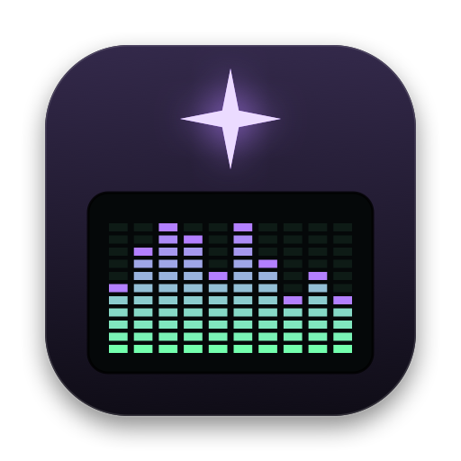

# Grimoire



A lightweight retro music player for macOS. Plays MP3, WAV, AIFF and FLAC. Native Swift and has no dependencies.

This is a personal project, built with [Claude Code](https://claude.com/claude-code).

## Install

Run `scripts/make-dmg.sh` to build `dist/Grimoire-<version>.dmg`. Open it and drag **Grimoire** onto **Applications**. The app is universal (Apple Silicon and Intel) and needs macOS 14 or later.

The app isn't signed with an Apple Developer ID, so on a Mac other than the one that built it, macOS blocks the first launch. Try to open it once, then go to **System Settings → Privacy & Security** and click **Open Anyway**. The comments at the top of `scripts/make-dmg.sh` explain how to sign and notarize it if you have a Developer ID.

## Build & run

```sh
./bundle.sh            # universal release build → build/Grimoire.app
open build/Grimoire.app
swift test             # core logic tests
open Package.swift     # work on it in Xcode
```

Requires macOS 14+.

## Using it

- Drop files or folders on the main window to play them, or on the playlist to add them.
- **Space** plays/pauses, **← / →** seek 5 s, **⌘O** opens files, **⌘⇧O** opens a folder, **⌘L** shows/hides the playlist, **⌘S** saves the playlist.
- Click the time to switch between elapsed and remaining.
- Click the visualizer to cycle **Spectrum → Oscilloscope → Off**, or right-click it / use Window → Visualization.
- **VIS** (or **⌘⇧V**) opens the visualizer window. Resize it, drag it anywhere, and double-click for full screen. Right-click it for scene options, a new orbit and band meters.
- Drag the playlist away to float it. Drag it back under the main window to dock it.
- Media keys and Control Center work. The playlist is restored on the next launch.

## Layout

- `Sources/GrimoireCore` contains pure logic (playlist, m3u, FLAC tags, time math, FFT, multiband analysis, three-body physics) and is unit tested.
- `Sources/Grimoire/Audio` has `PlayerEngine` (AVAudioEngine playback), `AudioTap` (samples for visualizers) and `TrackLoader` (tags).
- `scripts/` holds `make-dmg.sh` (installer) and `make-icon.swift` (redraws `Resources/AppIcon.icns`).
- `Sources/Grimoire/Model` has `PlayerController` (app state) and `NowPlaying` (media keys).
- `Sources/Grimoire/UI` holds the SwiftUI views, `UI/Visualizers/` the small LCD visualizers and `UI/SceneWindow/` the Metal visualizer window. `App/` holds windows, menus and the app delegate.

## Visualizers

`AudioTap` captures the player node's output (before volume) into a ring buffer. `VisualizerNSView` pulls a 2,048-sample window on every display refresh and hands it to the active `Visualization`. The view is layer-backed and driven by a display link, so it pauses when nothing is moving.

To add a style, write a class that conforms to `Visualization` (in `UI/Visualizers/`) and add a case to `VisualizationKind`. `SpectrumAnalyzer` and `BarDynamics` in GrimoireCore provide the FFT bands and the classic rise/fall/peak-hold motion.

### Visualizer window

`SceneHostView` (MetalKit) reads the tap through its own `TapReader`. It splits the audio into three bands (**0–120 Hz, 120–800 Hz, 800 Hz–20 kHz**) with `MultibandAnalyzer`, and `BandFollower` smooths them into envelopes and transient hits. The current `WindowScene` gets those values every frame. To add a scene, conform to `WindowScene` and add a case to `WindowSceneKind`.

**Three-Body** (`ThreeBodyScene`) runs a Newtonian three-body simulation (`ThreeBodySystem`). It starts from the figure-eight orbit, and each body belongs to one band:
- That band's level sets the body's mass.
- Bass also pumps up gravity, and the mids speed up time.
- A thermostat and a gentle bowl keep the chaotic dance in frame.

The shader draws the bodies' gravitational field as flowing rings, with feedback trails smeared along the pull of gravity. Bass pulses and zooms the image, the mids swirl it and shift its colors, and the highs add sparkle and a split-color edge.
